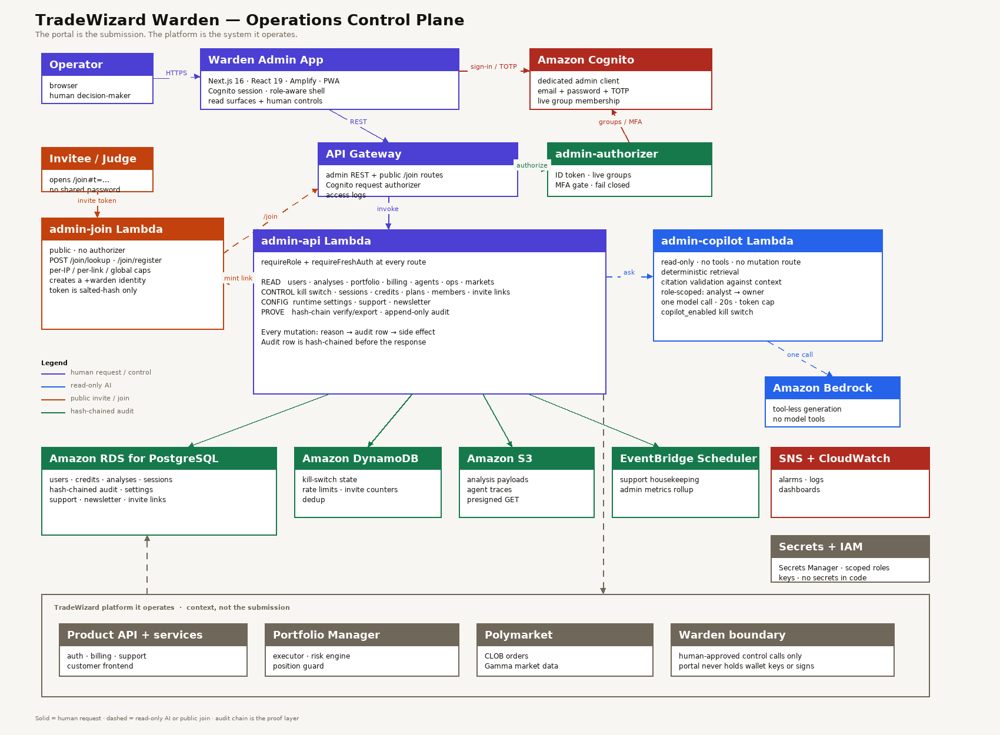

# TradeWizard Warden

> **Kiroween 2026 · Frankenstein category**
>
> The audited control surface for a live multi-agent prediction-market platform. A separate internal product, specified and documented by four Kiro specs during the submission period.

---

## What TradeWizard is

Most people have never used a prediction market, so start here.

A **prediction market** turns a question into a price. On "Will X happen?", YES shares trade between 0 and 100 cents and pay $1 if X happens. The price is the crowd's probability: 64 cents means the market thinks there is a 64% chance. Buying NO is buying the other side of the same question.

**TradeWizard** is a live product built on **Polymarket**, the largest prediction-market exchange. Orders are matched on Polymarket's central limit order book (the **CLOB**, which is also the API that places orders) and settled in USDC on Polygon. Customers reach it at `tradewizard.live`.

Customers use it in two ways:

1. **Analysis.** Fourteen AI agents read the news, polling, order books, and price history for a market. A deterministic pipeline fuses their answers into one probability, compares it with the market price, and returns either a **recommendation** (a direction, an entry zone, a target, a stop, and the reasoning) or **NO_TRADE** with a named reason. The result is delivered by email, in-app, or webhook. **Credits** meter usage, and plans refill them monthly.
2. **Portfolio Manager.** A customer can start a **session**: pick a market, a risk **persona**, and a budget. A deterministic risk pipeline decides each entry and exit inside that budget, tracks the position and P&L, and stops at the limits. These are real orders with real money, not a paper-trading view.

That is the system Warden operates: live customers, real balances, open positions, and orders that cannot be un-sent. A wrong click is not a bad dashboard state. It is money moved, a strategy stopped, or a change nobody can explain afterwards.

### The words this entry uses

| Term | What it means here |
|------|--------------------|
| Prediction market | An exchange on yes/no questions. Shares cost 0-100 cents and pay $1 if correct, so the price reads as a probability. |
| Polymarket | The exchange TradeWizard trades on. |
| CLOB | Central limit order book: the queue that matches orders, and the API that places them. |
| Analysis | One run of the fourteen-agent pipeline over one market. |
| Recommendation / NO_TRADE | A direction with entry, target, and stop, or a decision not to trade with a machine-readable reason. |
| Edge | The fused probability minus the market price. Positive edge is the reason to trade. |
| Credits | Prepaid units that pay for analyses; plans refill them each cycle. |
| Persona | A risk profile (scalper, sniper, contrarian, and so on) that shapes how a session enters and exits. |
| Session | One Portfolio Manager run: a market, a persona, a budget, positions, trades, and P&L. |
| Kill switch | A per-user halt. New entries stop synchronously, then open positions are exited asynchronously. |
| Shadow consensus | A second, agent-voted decision recorded beside the live one so the two can be graded later. |
| On-chain billing | Subscription payments in USDC on Polygon, verified by transaction hash. |

## Inspiration

Warden exists because of what the platform does: it holds customer balances, opens positions with real orders, and runs unattended between analyses. Every operator action can move money, stop a strategy, or change what thousands of analyses do next.

Operating that from the AWS console is possible, but unsafe and slow. Every action becomes a manual runbook: raw SQL for a refund, a Lambda invocation for a queue, a console click for a kill switch, a spreadsheet for who changed what. There is no role boundary between an analyst and an owner, no reason attached to a destructive action, and no durable record that the action happened.

We built Warden because a live trading platform needs a control plane, not a collection of console tabs. It is a separate internal product: its own Next.js application, its own API, its own Cognito client, its own audit trail, and its own deployment. It never holds wallet keys, never signs transactions, and never calls the CLOB. It asks the platform to act, and records who asked, why, and what changed.

The portal is the new artifact in this submission. The platform it operates is context.

Both matter, asymmetrically. Warden is the artifact to judge: its design, its controls, its audit chain, its copilot, and its Kiro build. TradeWizard is the evidence that the problem is real and that Warden's controls have something at stake. The platform is not claimed as new work; it is the reason the portal exists.

## What it does

The portal is a role-gated operations console with four jobs: observe, control, configure, and account for what happened.

**Observe.** Overview metrics, users and their credits/analyses/sessions/payments/notes, analyses with quality analytics and presigned payloads, portfolio sessions with trades and decisions, billing, agent calibration and cost, queues and alarms, markets, and the hash-chained audit log.

**Control.** A fail-closed per-user kill switch, session pause/resume/terminate, credit grants, plan overrides, account suspension, support notes, member invitations and removal, analysis cache invalidation, refunds, and market requeue.

**Configure.** Audited runtime settings, each with a named consumer: pause new analysis, edit the maintenance message, override the AI provider, pause new Portfolio Manager activations, tune support SLA, or disable newsletter opt-ins. A missing or unreadable setting falls back to the deployed default.

**Account for it.** Every mutation requires a reason and writes a hash-chained audit row before the side effect. The row records the actor, action, target, before/after state, request id, IP, user agent, and idempotency key. `row_hash` commits to the previous row, and terminal rows also carry a `completion_hash`, so a flipped status is detectable. Database triggers reject updates and deletes.

**Ask Warden.** A read-only AI copilot answers operational questions over the same data: “What changed in the last hour?”, “Summarize this ticket and draft a reply”, “Why did this analysis return NO_TRADE?”, or “What is the blast radius of resetting this kill switch?” Retrieval is deterministic and role-scoped; every factual claim cites the exact audit row, ticket, analysis, or session; and every suggested action is a link to an existing human control. The copilot has no mutation route, no tool loop, and its own `copilot_enabled` kill switch.

The portal also carries two customer-facing workflows: the support inbox with contextual ticket snapshots and tokenised threads, and the newsletter composer, subscriber list, and signed delivery webhooks.

It is installable as a PWA, but the service worker is deliberately minimal. It caches only content-hashed static assets. Navigations, API responses, React Server Component payloads, and presigned S3 URLs are never cached, so a shared machine cannot show a previous operator's shell.

## Why this is a Frankenstein

The portal is not one framework with a login screen. It is a chimera of systems that normally do not share a body:

- **A separate Next.js 16 application** that never enters the customer bundle
- **Amazon Cognito** for email + password + TOTP, admin groups, and a request authorizer
- **A dedicated admin API** on API Gateway, backed by Lambda
- **Amazon RDS for PostgreSQL** for business state and a hash-chained audit log
- **Amazon DynamoDB** for kill-switch state, rate limits, and concurrent claims
- **Amazon S3** for analysis payloads behind short-lived presigned URLs
- **EventBridge Scheduler** for housekeeping and metrics rollups
- **SNS and CloudWatch** for alarms and operational visibility
- **AWS Amplify Hosting** for a separate admin domain
- **A read-only AI copilot** with deterministic retrieval, grounded citations, no tool loop, and no mutation path
- **A conservative PWA service worker** that treats browser caching as a security decision

The unusual part is not any one service. It is the contract between them: the portal can stop a live trading system, but it cannot move money; it can change runtime behavior, but every change names its consumer and lands in an immutable log; it can read sensitive data, but it never holds the keys to act on-chain.

Kiro is the stitching. Four specs define the foundation, the operations layer, the audit chain, and the read-only copilot; four steering documents constrain the work, and hooks verify the parts most likely to drift.

## How we built it with Kiro

### Four specs, one control plane

The portal is specified and documented by four Kiro specs:

- **`admin-portal-foundation`** - package isolation, Cognito authentication, MFA bootstrap, four-tier RBAC, the hash-chained audit spine, the admin API contract, read surfaces, the UI shell, and the security checklist. It defines why the portal is a separate app and why the authorizer is the security boundary, not the hidden button.
- **`admin-portal-operations`** - the mutation envelope, the per-user kill switch, portfolio session controls, user and account operations, portal membership and invites, runtime settings, analysis operations, the support inbox, newsletter operations, and the verification rules.
- **`audit-chain-integrity`** - the canonical row hash, completion hash, advisory-lock serialization, idempotent backfill, bounded verification endpoint, and the audit UI's verified/broken states.
- **`admin-copilot`** - the read-only boundary, deterministic retrieval, citation validation, role scoping, one tool-less model call, and the evidence that no mutation path exists.

Each spec has requirements, a design, and an ordered task list. The tasks are checked against shipped code, not against a plan.

### Steering

Four steering documents under `.kiro/steering/` gave the agent the context that does not belong in a single prompt:

- `product.md` - the platform the portal operates, and the support/newsletter surfaces.
- `structure.md` - package boundaries; portal code stays in `tradewizard-admin/` and `admin-api`.
- `tech.md` - shared modules and the deterministic analysis invariants the portal must not bypass.
- `kiroween.md` - the submission constraints: category, license, honest claims, and demo rules.

The most useful rule was negative: the deterministic analysis stages must never contain model calls. That kept a portal change from quietly weakening the product it operates.

### Hooks

Five hooks automate the verification work:

| Hook | Trigger | What it runs |
|------|---------|--------------|
| `admin-typecheck` | Save an admin `.ts`/`.tsx` file | `npx tsc --noEmit` in `tradewizard-admin/` |
| `infra-typecheck` | Save an `infra/` TypeScript file | `npx tsc --noEmit` in `infra/` |
| `frontend-typecheck` | Save a frontend TypeScript file | `npx tsc --noEmit` in `tradewizard-frontend/` |
| `analysis-gate-guard` | Save a deterministic gate file | Agent review for model calls, shadow-data leakage, and missing tests |
| `spec-task-followthrough` | A spec task completes | Close `tasks.md`, run affected tests, reconcile docs |

The admin typecheck is the daily guardrail. The gate guard matters when a portal change reaches into the analysis pipeline.

### MCP

`.kiro/settings/mcp.json` connects Kiro to Magic Link and Polymarket documentation. The admin login and the product's order/market contracts are verified against the source instead of recalled.

### Property-based testing

The portal's authorization surface is covered by `fast-check` properties: role ranking, group-to-role resolution, order independence, `requireRole` across every role pair, the fresh-auth window, and bearer-token extraction. Each property runs 100-300 generated cases. The remaining suites are example-based.

## How it works



### Request flow

```
Operator browser
  │  Cognito email + password + TOTP
  ▼
tradewizard-admin/  (Next.js 16, Amplify)
  │  ID token + 30-day refresh token
  │  presence-only tw_admin_session cookie
  ▼
admin-api  (API Gateway REST + Cognito REQUEST authorizer)
  │  verify ID token → groups → role → MFA gate
  │  requireRole + requireFreshAuth at the handler
  ▼
shared modules → RDS PostgreSQL / DynamoDB / S3 / CloudWatch
                → Lambda invoke for support and newsletter workers
```

### Authentication and roles

Admin accounts are dedicated Cognito identities. Sign-in is email + password + TOTP on a separate admin client. MFA enrolment is self-service: the portal asks for status, shows a QR code, verifies the code, and records the enrolment only after Cognito confirms the factor.

Warden accounts are created on a `+warden` alias (`name@example.com` → `name+warden@example.com`), and the product refuses any `+tag` address, so a Warden identity can never double as a customer account. Owners can mint role-carrying invite links with a lifetime, use cap, and one-click revoke; the token lives in the URL fragment and only its SHA-256 is stored. The authorizer reads live Cognito group membership on every request, so a removal or demotion takes effect on the next request rather than when the ID token expires.

The four roles are cumulative:

| Role | Rank | Capability |
|------|------|------------|
| Analyst | 10 | Read-only metrics, analyses, agent performance |
| Support | 20 | Read all; credits, notes, resend, pause/resume sessions |
| Admin | 30 | All mutations except settings and role changes |
| Owner | 40 | Everything, including settings and membership |

Every handler re-checks the minimum role. The UI hides what a role cannot do, but hidden is never the security boundary. Destructive actions require a token fresher than 10 minutes and a reason. The last owner cannot be removed.

### Audit before the side effect

The audit row is inserted with `pending` status before the mutation runs, then completed as `succeeded` or `failed`. A crash leaves a visible pending row rather than an unrecorded action.

The table is also hash-chained. Each row carries `prev_hash` and `row_hash`; terminal rows also carry `completion_hash` and `completed_at`. The chain is ordered by `(created_at, id)`, and writes take a transaction-scoped advisory lock around read-head + insert so concurrent mutations cannot fork it. The portal verifies a bounded window, names the first broken row with a reason (`row_hash_mismatch`, `prev_hash_mismatch`, `completion_hash_mismatch`, and so on), and treats a break as a finding (`200`, `valid: false`) rather than a server error. Triggers reject `UPDATE` and `DELETE`.

### The kill switch

The kill switch is per-user and two-phase:

1. `activateUser` writes the DynamoDB state synchronously, so every trading path stops opening new positions before the API responds.
2. The risk engine is invoked asynchronously to cancel orders and exit positions. If that dispatch fails, the halt still stands, and the response says the exit failed so an operator can retry or exit manually.

It is available from the user detail page and the session detail page, so an incident does not require navigation.

### Runtime settings with real consumers

A setting is only allowed if a service reads it in the same change:

| Setting | Consumer | Effect |
|---------|----------|--------|
| `analysis_paused` | `analysis-request` | Refuse new analysis; schedules continue |
| `analysis_pause_message` | `analysis-request` | User-facing maintenance copy |
| `ai_provider` | `ai-provider` | Override the deployed provider |
| `pm_activations_paused` | `portfolio-activation` | Refuse new sessions; existing sessions continue |
| `support_enabled` | `support-api` | Refuse new tickets; unsubscribe still works |
| `support_first_response_target_hours` | support inbox | SLA and overdue flags |
| `newsletter_enabled` | `newsletter-api` | Hide opt-in; unsubscribe always works |
| `copilot_enabled` | `admin-api` + `admin-copilot` | Hide Ask Warden and refuse requests |
| `copilot_daily_limit` | `admin-api` | Per-operator daily request cap |

Reads are cached for 60 seconds per container. Synchronous consumers read a warmed cache; a missing row falls back to the declared default. Writes are owner-only, fresh-auth, reason-required, and audited.

### Support and newsletter

Support is a portal-only queue. Customers submit from the analysis or session that prompted the question; the ticket carries a context snapshot and a tokenised thread. Claim is a conditional update, replies take a row lock, another operator's ticket is refused unless the caller is admin, and internal notes never email. An hourly worker releases stale claims and closes resolved tickets.

Newsletter is a separate marketing channel. Campaigns are composed from typed templates, rendered with the production renderer, previewed in a sandboxed iframe, and sent only by an owner with fresh auth and a reason. The send claim is idempotent, the audience is snapshotted, deliveries are per-recipient unique, and the sender stops at a 5% failure ratio. Bounce and complaint webhooks verify the Svix signature over the raw body before suppressing an address.

### Ask Warden (read-only AI copilot)

The copilot answers operational questions over the same data: “What changed in the last hour?”, “Summarize this ticket and draft a reply”, “Why did this analysis return NO_TRADE?”, or “What is the blast radius of resetting this kill switch?”

The safety design is the feature. Retrieval is deterministic and parameterised, not natural-language-to-SQL. The model gets one tool-less call, a bounded context, and a 20-second timeout. Each record is wrapped as untrusted data; instructions inside a ticket or audit reason are ignored. Citations are validated against the records actually sent, so an invented citation is dropped and confidence is lowered. Role scoping reuses the same four-tier model. A suggested action is always a link to an existing human control; there is no `execute` variant, no mutation route, and no tool loop. `copilot_enabled` is a runtime kill switch, and `copilot_daily_limit` caps spend per operator. Questions are not audited as mutations; usage is a CloudWatch line with latency, tokens, cost, and citation count — never question text or record content.

### AWS service map

The portal is nine CDK stacks, with the platform as its subject:

- **AWS CDK + CloudFormation** - network, database, auth, storage, queues, notifications, compute, monitoring, and admin.
- **AWS Lambda (Node.js 20)** - admin API, authorizer, public join, copilot, metrics rollup, support housekeeping, newsletter sender.
- **Amazon API Gateway** - the admin REST API with a Cognito request authorizer and access logs.
- **Amazon Cognito** - the admin app client, four groups, TOTP, and the authorizer.
- **Amazon RDS for PostgreSQL 18.3** - users, credits, analyses, portfolio sessions, audit, settings, support, newsletter. Single-AZ `db.t4g.micro`, encrypted 20-50 GB, SSL enforced, 7-day production backups.
- **Amazon DynamoDB** - kill-switch state, rate limits, support claims, and dedup.
- **Amazon S3** - analysis payloads and agent traces behind presigned URLs.
- **Amazon EventBridge Scheduler** - hourly support housekeeping and the admin metrics rollup.
- **Amazon SNS** - alarm topic for authorizer denials, API 5xx, and rollup failures.
- **Amazon CloudWatch** - logs, metrics, dashboards, and alarms.
- **AWS Secrets Manager + IAM** - database, email, CLOB, wallet, webhook, and newsletter secrets; scoped handler roles.
- **AWS Amplify Hosting** - the admin portal on its own domain.
- **Amazon Bedrock** - read-only copilot generation, and the inference layer of the platform the portal operates.

## Challenges we ran into

**Operating a live system is a product, not a script.** The first version was a set of console runbooks. The hard part was designing a control surface that is fast during an incident but still forces a reason, a role, and an audit row.

**Fresh authentication was a dead end.** The API correctly returned `REAUTH_REQUIRED`, but the UI had no way forward. The fix was a reauthentication notice that signs out and returns to the same page, plus the rule that a refresh token does not reset `auth_time`.

**The last owner is a single point of failure.** Removing the final owner would lock everyone out. The check runs inside a transaction and returns `409 LAST_OWNER`; the UI cannot bypass it.

**A kill switch must fail closed.** The halt is written before the exit dispatch. If the dispatch fails, the halt remains and the operator sees that the exit failed. The safe direction is stopping, not retrying blindly.

**Settings are theatre without consumers.** Every switch names the service that reads it. A setting that stores a value nobody reads is worse than no switch, because it looks like control.

**Support concurrency.** Two agents can open the same ticket. Claim is a conditional update, replies take a row lock, and ownership is checked before a reply. The customer sees one thread, not two.

**Newsletter idempotency.** A retried send must not double-mail the list. The campaign claim, the unique `(campaign_id, email)` constraint, and per-delivery status transitions make a retry safe.

**PWA caching is a security decision.** A normal service worker would cache a previous operator's shell on a shared machine. This worker caches content-hashed assets only and serves an offline notice for navigations.

## Accomplishments we are proud of

- **A real control plane for a live trading system.** Not a CRUD dashboard: a role-gated, reason-required, hash-chained operations product.
- **Four-tier RBAC enforced twice.** The authorizer computes the role from live Cognito membership; every handler re-checks the minimum.
- **Access that cannot be shared by accident.** Warden accounts live on `+warden` aliases, the product refuses `+tag` addresses, and role-carrying invite links can be capped, expired, and revoked.
- **An audit spine that proves itself.** Inserted before the side effect, hash-chained, append-only at the database layer, with before/after state and a verifier that names the first broken row.
- **A fail-closed kill switch.** Synchronous halt, asynchronous exit, explicit failure reporting.
- **Runtime settings with named consumers.** Pause analysis, pause new Portfolio Manager sessions, or change the provider without a deploy.
- **Support and newsletter in the same control plane.** Contextual tickets and consent-first campaigns, not bolted-on tools.
- **A read-only AI copilot with citations.** Ask Warden explains incidents, tickets, analyses, sessions, and risky actions, cites the exact record, and has no mutation path.
- **A PWA that does not leak the previous operator.** Static assets only; no navigations, API data, RSC payloads, or presigned URLs in the cache.
- **Four Kiro specs that trace the portal end to end.** Foundation, operations, audit chain, and admin copilot, each with requirements, design, and completed tasks.

## What we learned

- **Admin UX is safety UX.** A confirmation dialog is not enough; the reason, role, and audit row are the actual safety features.
- **Write the audit row before the action.** An append-after-success model loses the record when the process dies.
- **Every setting needs a consumer.** Otherwise the portal lies about control.
- **Fresh auth is not friction to remove.** It is the difference between a stolen session and a kill switch.
- **Caching is a security boundary.** The PWA rules are part of the threat model, not a performance tweak.
- **Specs keep a control plane coherent.** The portal has too many cross-cutting rules for prompt-only development.

## What's next for TradeWizard Warden

- **Portfolio Manager session-cap override** as a runtime setting with a real consumer.
- **Maintenance banner** coordinated with the product frontend.
- **Model routing view** once a configuration source exists.
- **HMAC key anchor for the audit chain**, so a database-only actor cannot re-seal a break.

---

## Kiro usage summary

| Kiro capability | Evidence in this repository |
|-----------------|-----------------------------|
| Spec-driven development | `admin-portal-foundation`, `admin-portal-operations`, `audit-chain-integrity`, and `admin-copilot`, each with requirements, design, and completed tasks |
| Steering | `.kiro/steering/product.md`, `structure.md`, `tech.md`, `kiroween.md` |
| Agent hooks | 5 hooks, including `admin-typecheck`, `analysis-gate-guard`, and `spec-task-followthrough` |
| MCP | `.kiro/settings/mcp.json` with Magic Link and Polymarket documentation |
| Custom agents | Not claimed; the repository's steering and specs are the context mechanism |

The full judge-facing write-up is in [docs/kiro-usage.md](https://github.com/balojey/tradewizard-kiroween/blob/main/docs/kiro-usage.md).

## Built with

Kiro · TypeScript · Next.js 16 · React 19 · Tailwind CSS 4 · TanStack Query · Amazon Cognito · API Gateway · AWS Lambda · Amazon RDS for PostgreSQL · Amazon DynamoDB · Amazon S3 · Amazon EventBridge · Amazon SNS · Amazon CloudWatch · AWS Secrets Manager · AWS IAM · AWS Amplify Hosting · AWS CDK · Zod · Vitest · Remotion

Platform context: Amazon Bedrock · Strands Agents SDK · Polymarket CLOB and Gamma APIs · viem · Safe · USDC.e on Polygon · Resend · NewsData.io · Serper

## Links

- **Repository**: https://github.com/balojey/tradewizard-kiroween
- **Operations portal**: https://warden.tradewizard.live
- **Platform it operates**: https://tradewizard.live
- **Kiro usage write-up**: https://github.com/balojey/tradewizard-kiroween/blob/main/docs/kiro-usage.md
- **Portal foundation spec**: https://github.com/balojey/tradewizard-kiroween/blob/main/.kiro/specs/admin-portal-foundation/requirements.md
- **Portal operations spec**: https://github.com/balojey/tradewizard-kiroween/blob/main/.kiro/specs/admin-portal-operations/requirements.md
- **Audit chain spec**: https://github.com/balojey/tradewizard-kiroween/blob/main/.kiro/specs/audit-chain-integrity/requirements.md
- **Admin copilot spec**: https://github.com/balojey/tradewizard-kiroween/blob/main/.kiro/specs/admin-copilot/requirements.md
- **Architecture diagram**: https://github.com/balojey/tradewizard-kiroween/blob/main/docs/warden-architecture.png

---

**Note**: Warden is an internal control surface. It is not linked from the customer product. TradeWizard's market analysis is provided for educational and informational purposes; all trading involves risk.
