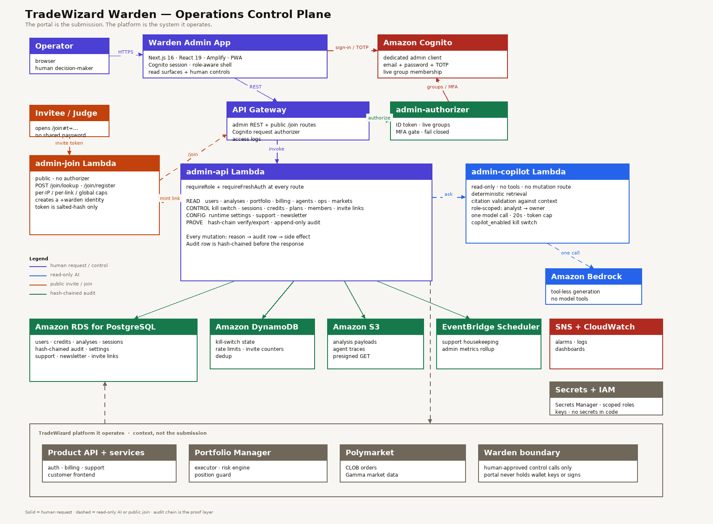
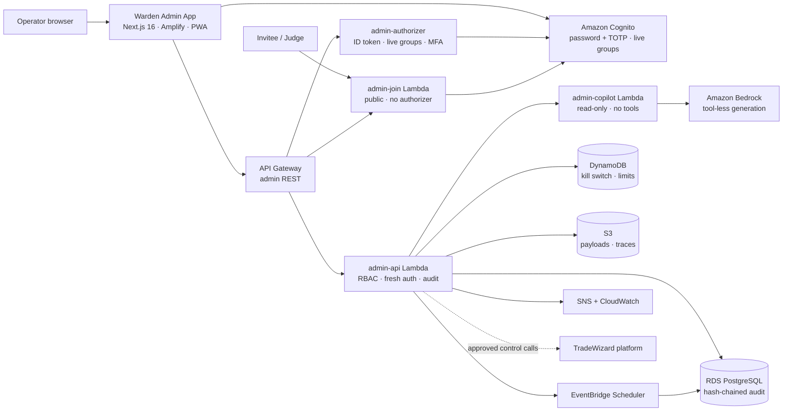

# Warden Architecture

The platform diagram (`docs/tradewizard-architecture.png`) shows the product the portal operates. This diagram shows **Warden itself** — the submitted artifact.

## What the diagram shows

| Layer | Components |
|-------|------------|
| Operator surface | Browser → Warden Admin App (Next.js 16, Amplify, PWA) |
| Identity | Amazon Cognito admin client, email + password + TOTP, live group membership |
| API edge | API Gateway admin REST API + Cognito request authorizer |
| Portal backend | `admin-api` Lambda: read surfaces, controls, settings, support, newsletter, audit |
| AI | `admin-copilot` Lambda → Amazon Bedrock, read-only, one tool-less call |
| Public access | `admin-join` Lambda behind `/join/lookup` and `/join/register`, invite links, `+warden` aliases |
| State | RDS PostgreSQL (hash-chained audit, settings, support, newsletter), DynamoDB (kill switch, rate limits, invite counters), S3 (payloads, traces) |
| Operations | EventBridge Scheduler (housekeeping, rollups), SNS + CloudWatch (alarms, logs), Secrets Manager + IAM |

## The three paths

1. **Human control path** — operator → Warden app → API Gateway → authorizer → `admin-api` → RDS/DynamoDB/S3, and approved control calls to the platform services.
2. **Read-only AI path** — `admin-api` → `admin-copilot` → Bedrock. The copilot has no mutation route, no tools, and returns citations to the records it read.
3. **Public join path** — judge/invitee → invite link → `admin-join` → Cognito creates a dedicated `+warden` identity. The link is capped, expiring, and revocable.

## The proof layer

Every mutation writes a hash-chained audit row before the side effect. The portal verifies the chain in bounded windows and names the first broken row. That is the difference between “the portal says it audited the action” and “the portal can prove the record is intact.”

## Mermaid source

The PNG is the version to attach to the Devpost submission and the demo deck. The Mermaid source is for anyone reading the repository on GitHub.
